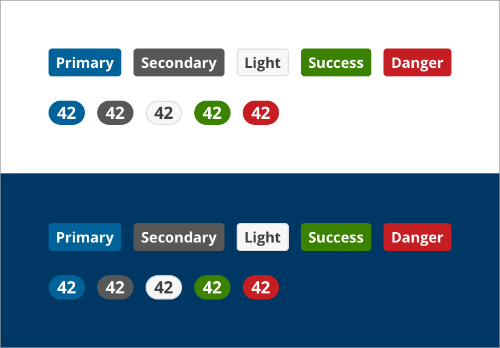
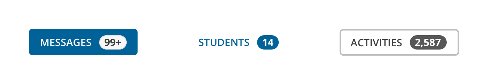
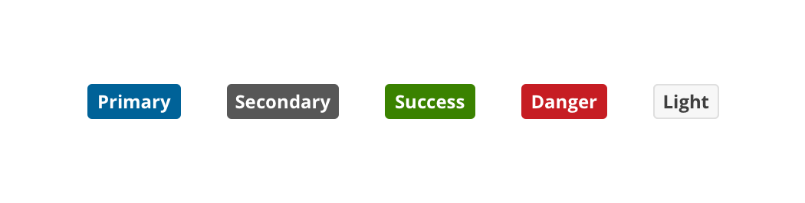

import './design-guidelines-styles.css';

<PageContent componentName="badge" type="design">

<LeadParagraph>
  A badge is a compact visual label that highlights important information about
  an object, helping users quickly understand its status, significance, or
  required action.
</LeadParagraph>

<figure>
  
</figure>

---

## Text Badges

<figure>
  
</figure>

Use text badges to communicate a short status or state. Keep labels concise and place the badge close to the object it describes. Leading or trailing icons may reinforce the label’s meaning but should not replace it.

A badge may be clickable when the action is directly related to its content. For example, selecting a “3 issues” badge could open a filtered list of those issues. Do not use badges in place of standard buttons for primary or unrelated actions.

---

## Counters

<figure>
  
</figure>

Use counters to show a quantity associated with a nearby object or action, such as unread messages or pending tasks. Show the exact value when it affects a decision; otherwise, use a maximum such as “99+.”

Always provide context for the number, including an accessible label such as “42 students” rather than simply “42.”

---

## Color

<figure>
  
</figure>

Badge colors fall into two groups: semantic colors and decorative brand colors. Choose the color based on whether the badge communicates a specific meaning or simply needs to support the visual hierarchy of the interface.

Use semantic colors when the badge represents a recognizable status. Success indicates a positive or completed state, warning calls attention to something that may require action, danger identifies a critical or blocked state, and information communicates a neutral update or an in-progress state. Apply these meanings consistently throughout the product so users can learn and recognize them.

Use neutral or accent colors when the badge does not carry semantic meaning. Neutral options work well for general labels and lower-emphasis statuses, while accent options can add distinction or reflect the Cengage brand. Color should reinforce the text label, never replace it as the only way meaning is communicated.

</PageContent>
