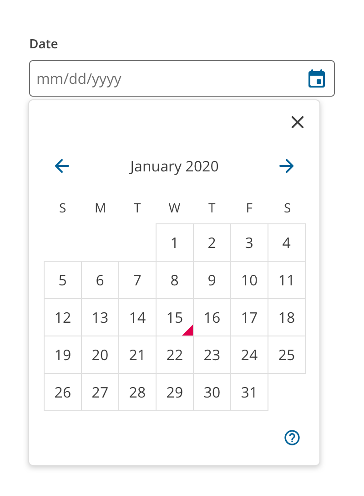

<PageContent componentName="date_picker" type="design">

<LeadParagraph>
  A date picker allows the user to select a particular date.
</LeadParagraph>

## Usage

Use the date input when you want the user to input a date in the format you choose. A built-in calendar widget and keyboard controls improve the general usability and accessibility of the component.

  
  

</PageContent>
