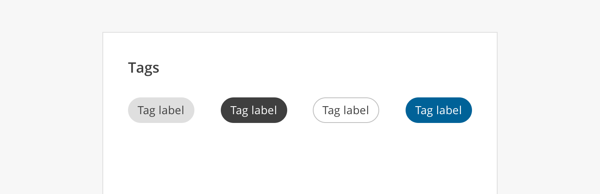
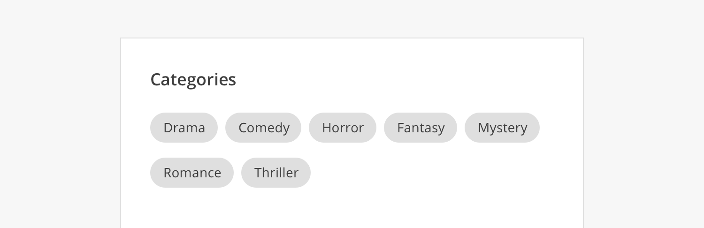
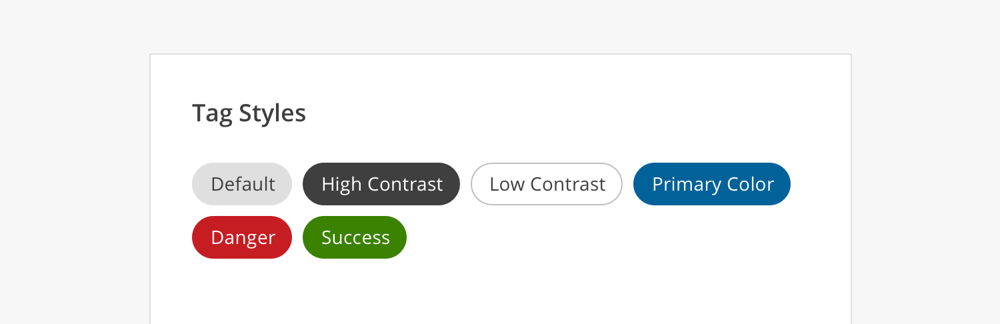
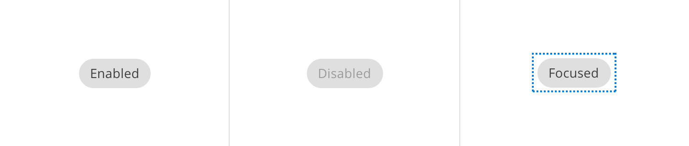
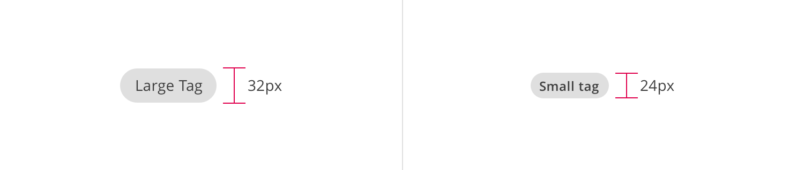
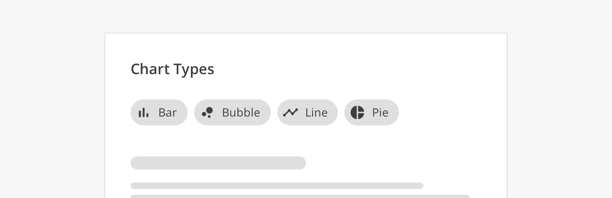
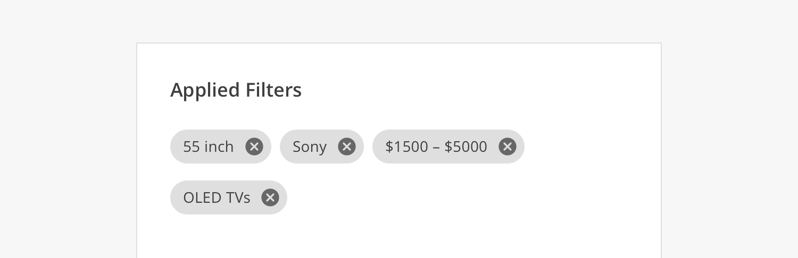

import './design-guidelines-styles.css';

<PageContent componentName="tag" type="design">

<LeadParagraph>
  Tags are compact labels that help categorize and organize content.
</LeadParagraph>

## Usage

Multiple or single tags can be used to categorize items.

Use short labels for easy scanning. Use two or more words only if necessary.

### When to use

#### Categories

Use tags when content belongs to multiple categories, and the user needs a way to differentiate between them.

---

## Colors

Tags are available in a range of colors to help you organize and categorize information.

---

## States

In addition to a tag’s default state, a tag may also display the following states.

### Focused

When a tag can be interacted with, it may receive focus and therefore will display the same focus state used on other components.

### Disabled

Interactive tags may be disabled to make it clear they can not be interacted with at that time.

---

## Sizes

Tags have two sizes available. The default size is designed to fit most scenarios and a smaller size can be used for scenarios where space is limited for the number of tags that need to be displayed.

---

## Tags With Icons

A leading icon may be added to the tag. This can help clarify the meaning of a tag or what it represents.

---

## Dismissible Tags

Tags can include a close button on the right side. Using this close button completely removes it from the UI. This can be especially useful for something like search filters. In this scenario, a tag could be used when applying a filter to a list of search results, and then dismissing the tag removes the filter.

</PageContent>
